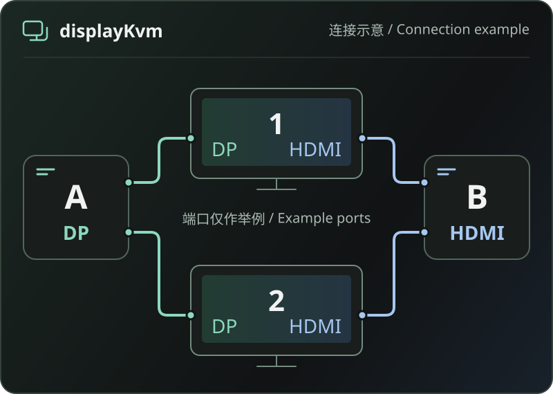

# displayKvm

[简体中文](README.md) | English

**Switch monitor inputs between computers.**

Manage display inputs with a desktop application, command-line client, and local background process. Each computer controls its own monitor connections; no network remote-control service is required.

[Download a candidate](#download-a-candidate) · [Quick start](#quick-start) · [Platform status](#platform-status) · [User guide](docs/usage/README.md) (Chinese) · [MIT license](LICENSE)

> **Prerelease candidate** · Software builds, CI, and archive download checks have passed. Packaged applications and real hardware behavior still require testing on real systems.



*Connection diagram, not an application screenshot: two computers connect to the same two displays. DP and HDMI are examples; configure input mappings for your own devices.*

## What you can do

- **Switch a display or a group:** save target computers and input mappings, choose a scope, and inspect results for each display.
- **Keep configuration together:** displays, input schemes, targets, groups, event rules, and schedules live in one complete settings file.
- **Use events and schedules:** configure event rules, scheduled actions, and current-user login startup. Available events depend on capabilities reported by the background process.
- **Use the desktop or CLI:** manage configuration, inspect status, and test saved targets in the desktop application, or use the Go command-line client with the same background process.

Actual control depends on the monitor, DDC/CI, drivers, and connection path. **A submitted command or matching input readback is not visual confirmation that the picture changed.**

## Download a candidate

**[Get v0.0.1-rc.20261107.12 →](https://github.com/orzlees/display-kvm/releases/tag/v0.0.1-rc.20261107.12)**

Choose an archive for your operating system, CPU architecture, and archive type, then check its matching SHA-256 file. The release contains nine archives and nine checksum files. The [candidate build and release workflow](https://github.com/orzlees/display-kvm/actions/runs/42381983666) passed.

These are prerelease candidates, not full installers, and have no trusted distribution signature. The macOS app uses an ad-hoc signature and is not notarized. The packaged applications have not been run on real systems; monitor, USB, login, and sleep/wake behavior still require real-system testing.

## Platform status

| Platform | Current candidate scope |
| --- | --- |
| macOS Apple Silicon | arm64 app candidate with bundled `m1ddc v1.3.1`. The local desktop build targets macOS 13 or later. |
| macOS Intel | The display-control backend is unavailable. |
| Windows amd64 / arm64 | Native standard VCP input control and cross-compiled desktop candidates. The candidate baseline is Windows 10 1803 (build 17134). |
| Linux amd64 / arm64 | rc12 includes both architectures' tool payloads, with release gates passed. The baseline is Debian 12 / glibc 2.36; target-system operation and distribution compatibility remain unverified. |

**This scope is not evidence of real-system or hardware compatibility.** DDC/CI must be enabled on the monitor, and cabling, docks, drivers, and permissions must allow access. Control while another video input is active depends on the actual connection. See [compatibility and evidence boundaries](docs/compatibility.md) (Chinese).

<details>
<summary>Platform details and verification limits</summary>

**macOS:** Apple Silicon uses bundled `m1ddc v1.3.1`, selecting displays by UUID and sending `input` or `input-alt` with decimal input values. Real monitors, the desktop WebView, and DDC/CI control while another input is active still require real-system testing.

**Windows:** the standard VCP path needs no separate display-control tool. The AMD/LG special-protocol path is amd64 only and uses the current user's installed AMD driver, source address `0x50`, and private command `0xF4`; standard VCP `0x60` is not a substitute. Missing drivers, ambiguous target mappings, or failed identity checks prevent submission. This path has no reliable readback and does not offer the five-second input preview. The arm64 standard path and desktop candidate do not imply support for this special path.

Windows also depends on the required local filesystem capabilities. WebView2, installation, permissions, login startup, and monitor switching have not completed real-system validation. Focused tests and cross-compilation do not prove native Windows operation or real input switching. See the [task plan](docs/任务计划/【20261105-显示器切换工具开发】.md) (Chinese) and its verification evidence for the recorded status.

**Linux:** rc12 bundles `ddcutil`, `busctl`, and `udevadm` for amd64/arm64. Native payload generation and strict build, dependency-closure, source, and license release gates passed. The host still needs I2C device permissions, appropriate drivers, and a D-Bus/logind/udev environment; the tools do not install services or change permissions automatically. Packaged applications have not been run on real systems, so distribution and monitor compatibility remain unverified.

Linux candidates require natively generated `ddcutil 3.0.2`, systemd 258 tools, dependency libraries, complete source, and licenses. A release missing either architecture's payload must not be presented as a complete cross-platform candidate.

</details>

## Quick start

### 1. Prepare a complete settings file

Settings can be opened while the background process is offline. Create a configuration, use Save as to select a file, and save the file selection. Use a complete settings file whose `configuration` section is version 3. An empty generated document has no device mappings and cannot switch a monitor. Configure real display identities, input mappings, and targets, then validate the configuration.

Replace sample paths, display IDs, UUIDs, USB IDs, and input values with your own values. See the [configuration contract](docs/contracts.md) (Chinese) and the source commands under [Build and package](#build-and-package). Creating or saving a file selection does not start the background process or enable login startup.

### 2. Start the background process and desktop separately

The desktop application does not start the background process automatically. Start `displaykvmd` with the **absolute path** to your complete settings file, keep it running, then open the desktop application. Both must run under the same user and configuration environment.

<details>
<summary>macOS Apple Silicon desktop candidate</summary>

From the directory containing `DisplayKvm.app`, start its bundled background process:

```sh
DisplayKvm.app/Contents/MacOS/displaykvmd -settings '/absolute/settings.json'
```

Keep that terminal open, then start the desktop application in another terminal:

```sh
DisplayKvm.app/Contents/MacOS/displaykvm
```

Keep the application bundle and its bundled tools together. The CLI is at `DisplayKvm.app/Contents/MacOS/displaykvm-cli`.

</details>

<details>
<summary>Windows desktop candidate</summary>

In PowerShell, from the extracted directory, start the background process with your own settings path:

```powershell
.\displaykvmd.exe -settings 'C:\Users\USERNAME\Documents\DisplayKvm\settings.json'
```

Keep it running, then open the desktop application from another PowerShell window:

```powershell
.\DisplayKvm.exe
```

The CLI in the desktop candidate is `displaykvm-cli.exe`. See the [Windows candidate guide](docs/usage/windows-candidate.md) (Chinese) for its three executable files and prerequisites.

</details>

### 3. Connect, inspect status, and save targets

Connect the desktop application to the background process to manage devices and input mappings, save targets, and choose a single display or group. The source and core CLI is named `displaykvm`, with source entry point `cmd/displaykvm`; the CLI in desktop candidates is named `displaykvm-cli`. Archive contents differ; see the [user guide](docs/usage/README.md) and [packaging guide](packaging/README.md) (both Chinese).

On macOS and Windows, login startup runs **after the current user signs in**. Configure the background process and desktop login entries separately; they are not pre-login system services. Closing the main window hides the desktop application. Explicitly quitting from the tray ends the desktop client and does not stop the background process.

**Update the background process and desktop together.** The interface does not replace or stop an older background process. Exit old programs using their original startup method before starting the new background process and desktop.

## Five-second input preview

Save a target before testing it from a visible local screen. The background process handles displays one at a time: it reads the actual current input, submits the target switch, then attempts to restore the original input after the five-second hold. **Timing starts when the switch call returns; target verification readback counts toward those five seconds. The period is per display, not for the entire group.**

- If the original input cannot be read reliably or reading is unavailable, that display is not switched. A display already using the target input is skipped.
- If restoration first reads the original input, no additional write is needed. A third input value, different from both the original and target, is treated as a conflict and left unchanged.
- A failed, unknown, or conflicting restoration stops previews for subsequent displays. Restoration succeeds only after the original input is read back again.
- Timing and restoration belong to the background process; closing or reloading the page does not cancel them. A finished countdown, request timeout, or disconnected interface does not prove restoration. After disconnection, query the original test session instead of starting another preview.

A disconnected DDC/CI control path, a killed background process, or a power failure can prevent restoration. Be ready to select the local input through the monitor's OSD (on-screen menu). The Windows AMD/LG special-protocol path has no reliable readback and does not offer this preview. Read the [preview behavior and limits](docs/usage/input-preview.md) (Chinese) before using it.

## Build and package

<details>
<summary>Source development, builds, and packaging</summary>

The source requires Go 1.26.10 or later; the current candidate was built with Go 1.27.3. The desktop is a separate Go module. macOS desktop builds also need Xcode/Clang and CGO; the macOS script uses the local toolchain (`GOTOOLCHAIN=local`).

These `go run` examples are for source development. On macOS, bare `go run` does not bundle `m1ddc`; running outside the app bundle without an advanced tool-path override reports a missing dependency. For everyday macOS use, prefer the complete `.app` and its bundled background process. Advanced source overrides are described in the [user guide](docs/usage/README.md) (Chinese).

Create and validate a complete settings file, filling in real device mappings and calibration results:

```sh
go run ./cmd/displaykvm config new --file '/absolute/settings.json'
go run ./cmd/displaykvm config check --file '/absolute/settings.json'
```

Start the background process with the absolute path to that file:

```sh
go run ./cmd/displaykvmd -settings '/absolute/settings.json'
```

Keep it running, then use the CLI in a second terminal:

```sh
go run ./cmd/displaykvm list
go run ./cmd/displaykvm status
go run ./cmd/displaykvm --json status
```

For a macOS Apple Silicon source build, build the app and start its bundled background process:

```sh
sh desktop/build-macos.sh
desktop/bin/DisplayKvm.app/Contents/MacOS/displaykvmd -settings '/absolute/settings.json'
```

Then open the desktop application in another terminal:

```sh
desktop/bin/DisplayKvm.app/Contents/MacOS/displaykvm
```

Build and package a core candidate:

```sh
sh build/build-core.sh --target all --version 0.0.1-dev --run-id local-core
sh packaging/package.sh core --run-id local-core
```

Build and package a macOS desktop candidate:

```sh
sh desktop/build-macos.sh
sh packaging/package.sh desktop --app desktop/bin/DisplayKvm.app --run-id local-desktop
```

Linux builds require matching, verified Linux tool payloads; these commands do not generate those payloads on macOS or Windows. Build output, caches, raw validation records, and local configuration are not included in Git. A successful build or cross-compilation does not establish target-system or hardware operation. Follow the [build guide](build/README.md) and [packaging guide](packaging/README.md) (both Chinese) for prerequisites, outputs, and arguments.

</details>

## Documentation and licenses

- [Documentation index](docs/README.md) (Chinese)
- [User guide](docs/usage/README.md) (Chinese)
- [Five-second input preview](docs/usage/input-preview.md) (Chinese)
- [Compatibility](docs/compatibility.md) (Chinese)
- [Packaging](packaging/README.md) (Chinese)
- [Contributing](CONTRIBUTING.md) (Chinese)
- [Project license](LICENSE)

Project code uses the [MIT License](LICENSE). Go, Wails, m1ddc, and other third-party components retain their own licenses. Keep the third-party notices, licenses, source materials, manifests, and checksums that accompany a distribution. Bundled materials are under `packaging/` and `third_party/`; macOS tool source and licensing materials are under `third_party/m1ddc/`.
