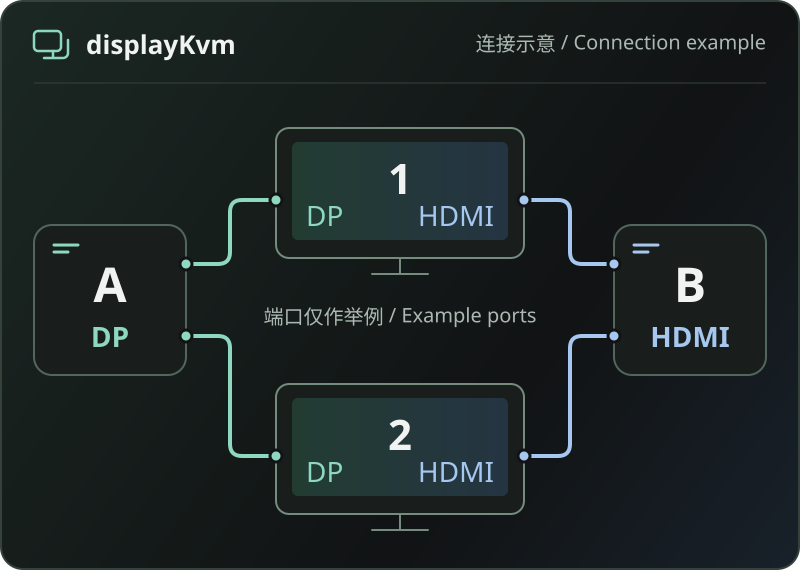

# displayKvm

简体中文 | [English](README.en.md)

**在多台电脑之间，切换显示器输入源。**

通过桌面、命令行和本机后台管理显示器输入。每台电脑控制自己的显示器连接，无需网络远控服务。

[下载候选](#下载候选) · [快速开始](#快速开始) · [平台状态](#平台状态) · [使用指南](docs/usage/README.md) · [MIT 许可](LICENSE)

> **预发布候选** · 软件构建、CI 与归档下载校验已通过；发布包内程序与真实硬件行为仍待实机验证。



*连接示意，非应用截图：两台电脑分别接入同两块显示器。DP、HDMI 仅作举例，实际输入映射需按设备配置。*

## 能做什么

- **按屏或屏组切换**：保存目标主机与输入映射，选择一块显示器或一个分组应用目标，查看逐屏结果。
- **集中管理配置**：显示器、输入方案、目标、分组、事件规则和定时任务保存在同一份完整设置文件中。
- **按事件与日程执行**：配置事件规则、定时任务及当前用户登录后启动；可用事件以后台实际报告的能力为准。
- **桌面与命令行共用后台**：在桌面管理配置、查看状态、测试已保存目标，也可通过 Go 命令行客户端操作。

实际控制能力取决于显示器、DDC/CI、驱动和连接链路。**命令已发送或输入已读回，不等于人工确认画面已切换。**

## 下载候选

**[获取 v0.0.1-rc.20261107.12 →](https://github.com/orzlees/display-kvm/releases/tag/v0.0.1-rc.20261107.12)**

按操作系统、CPU 架构和归档类型选择文件，再核对对应的 SHA-256 校验文件。当前发布包含九份归档及九份对应校验文件，[构建与发布流程](https://github.com/orzlees/display-kvm/actions/runs/42381983666)已通过。

这些是预发布候选，不是正式安装包，也未提供受信任的分发签名；macOS 使用 ad-hoc 签名且未经公证。发布包内程序尚未实机运行，真实显示器、USB、登录和睡眠唤醒行为仍待验证。

## 平台状态

| 平台 | 当前候选边界 |
| --- | --- |
| macOS Apple Silicon | arm64 桌面候选，随包使用固定版本 `m1ddc v1.3.1`；本地桌面构建最低部署版本为 macOS 13。 |
| macOS Intel | 显示器控制后端尚不可用。 |
| Windows amd64 / arm64 | 系统原生标准 VCP 输入控制及桌面交叉编译候选；最低候选基线为 Windows 10 1803（build 17134）。 |
| Linux amd64 / arm64 | rc12 双架构随包工具载荷已生成并通过发布门禁；基线为 Debian 12 / glibc 2.36，目标系统运行与发行版兼容性仍待验证。 |

**这些边界不代表对应系统或硬件已实测兼容。** 显示器需开启 DDC/CI，线缆、扩展坞、驱动和权限也须允许访问；本机切到非当前输入后能否继续控制，取决于实际链路。完整边界见[兼容说明](docs/compatibility.md)。

<details>
<summary>平台技术细节与验证边界</summary>

**macOS：**Apple Silicon 按显示器 UUID 调用随包 `m1ddc v1.3.1` 的 `input` 或 `input-alt`，输入值使用十进制。真实显示器、桌面 WebView 和非当前输入的 DDC/CI 能力仍需实机验证。

**Windows：**标准 VCP 路径无需另装显示器控制工具。AMD/LG 特殊输入提交仅限 amd64，使用当前用户已安装的 AMD 驱动、源地址 `0x50` 和私有命令 `0xF4`，不能替换为标准 VCP `0x60`。驱动缺失、目标映射不唯一或身份校验失败时拒绝发送。该特殊路径没有可靠读回，不能使用五秒输入测试；arm64 的标准路径与桌面候选不表示支持这条特殊路径。

Windows 仍依赖相关本地文件系统能力。WebView2、安装、权限、登录启动和显示器切换等尚未完成实机验收；定向测试和交叉编译不等于 Windows 原生运行或真实切屏通过。实际完成状态以[任务计划](docs/任务计划/【20261105-显示器切换工具开发】.md)和对应验证证据为准。

**Linux：**rc12 已生成 amd64/arm64 的 `ddcutil`、`busctl`、`udevadm` 随包载荷，通过构建、依赖闭包、来源和许可发布门禁。宿主仍需 I2C 设备权限、相应驱动及 D-Bus/logind/udev 环境，工具不会自动安装服务或修改权限。发布包尚未实机运行，不能据此推断所有发行版或显示器兼容。

Linux 候选要求原生生成的 `ddcutil 3.0.2`、systemd 258 相关工具、依赖库、完整源码和许可证；缺少任一架构载荷时，不得作为完整跨平台候选发布。

</details>

## 快速开始

### 1. 准备完整设置文件

后台离线时也可打开桌面“设置”，新建配置、另存为文件并保存文件选择。使用完整设置文件，其中 `configuration` 部分版本为 3；生成的空配置没有设备映射，不能直接切屏。请按实际设备与校准结果填写显示器身份、输入映射和目标，并检查配置。

示例路径、显示器 ID、UUID、USB ID 和输入值都需要替换。文章参数的脱敏字段片段见[配置契约](docs/contracts.md#文章参数与绑定字段示例)，源码创建与检查命令见下方[构建与包装](#构建与包装)。新建或保存文件选择不会启动后台，也不会自动启用登录启动。

### 2. 分别启动后台和桌面

桌面不会自动启动后台。使用完整设置文件的**绝对路径**启动 `displaykvmd`，保持后台运行，再打开桌面。两者应在同一用户及配置环境中运行。

<details>
<summary>macOS Apple Silicon 桌面候选</summary>

在包含 `DisplayKvm.app` 的目录中启动包内后台：

```sh
DisplayKvm.app/Contents/MacOS/displaykvmd -settings '/absolute/settings.json'
```

保持该终端运行，在另一个终端打开桌面：

```sh
DisplayKvm.app/Contents/MacOS/displaykvm
```

请保留完整应用包及其随包工具，CLI 位于 `DisplayKvm.app/Contents/MacOS/displaykvm-cli`。

</details>

<details>
<summary>Windows 桌面候选</summary>

在解压目录的 PowerShell 中启动后台，将示例路径替换为自己的完整设置文件：

```powershell
.\displaykvmd.exe -settings 'C:\Users\USERNAME\Documents\DisplayKvm\settings.json'
```

保持后台运行，从另一个 PowerShell 窗口启动桌面：

```powershell
.\DisplayKvm.exe
```

桌面候选中的命令行客户端为 `displaykvm-cli.exe`。三个程序的布局与前置条件见 [Windows 候选使用说明](docs/usage/windows-candidate.md)。

</details>

### 3. 连接、查看状态并保存目标

桌面连接后台后，可管理设备和输入映射、保存目标，再选择单屏或屏组进行操作。源码及核心 CLI 名为 `displaykvm`，源码入口是 `cmd/displaykvm`；桌面候选中的 CLI 名为 `displaykvm-cli`。不同归档的组成请按[使用指南](docs/usage/README.md)和[包装说明](packaging/README.md)确认。

macOS 与 Windows 的登录启动是**当前用户登录后**的安排，后台和桌面需分别配置，不是登录前系统服务。关闭主窗口只会隐藏桌面；从托盘显式退出只结束桌面，不会停止后台。

**更新时需同时换用新版后台和桌面。** 界面不会自动替换或停止旧后台，请先按原启动方式退出旧程序，再启动新版后台和桌面。

## 五秒输入测试

保存目标后，在本机画面可见时点击“测试已保存目标”。后台按显示器逐屏读取测试前的真实输入、切到目标，并在五秒保持期后尝试恢复原输入。**从切换调用返回时起计时，目标验证读回耗时计入五秒；不是整个多屏测试共用五秒。**

- 预读失败、缺少可靠读值或读取能力时不切换；原输入与目标相同则跳过。
- 恢复前已读到原输入时无需再写；读到既非原输入、也非目标的第三个值时，不覆盖该输入。
- 任一屏恢复失败、结果未知或出现冲突时，停止后续屏的测试。只有重新读回原输入，才显示恢复成功。
- 计时和恢复由后台负责，页面关闭或重新加载不会取消；倒计时结束、请求超时或界面断线不能证明已经恢复。失联后只查询原测试会话，不要重复发起测试。

若切走后 DDC/CI 控制通路断开，或后台被强杀、机器断电，自动恢复可能失败，需要通过显示器 OSD（屏幕菜单）手动切回。Windows AMD/LG 特殊路径没有可靠读回，不提供此测试。使用前请阅读[五秒测试说明](docs/usage/input-preview.md)。

## 构建与包装

<details>
<summary>展开源码开发、构建与打包步骤</summary>

源码最低 Go 版本为 1.26.10，当前候选构建使用 Go 1.27.3。桌面是独立 Go 模块；macOS 桌面构建还需要 Xcode/Clang 和 CGO。macOS 桌面脚本使用本机工具链（`GOTOOLCHAIN=local`）。

以下 `go run` 示例用于源码开发。macOS 裸 `go run` 不会自动附带 `m1ddc`；程序不在 `.app` 内且未设置高级工具路径覆盖时，会报告缺少依赖。macOS 日常运行请优先使用完整 `.app` 与包内后台；源码高级路径覆盖见[完整使用说明](docs/usage/README.md)。

创建并检查完整设置文件，按实际设备与校准结果填写配置：

```sh
go run ./cmd/displaykvm config new --file '/absolute/settings.json'
go run ./cmd/displaykvm config check --file '/absolute/settings.json'
```

使用完整设置文件的绝对路径启动后台：

```sh
go run ./cmd/displaykvmd -settings '/absolute/settings.json'
```

保持后台运行，在另一个终端使用 CLI：

```sh
go run ./cmd/displaykvm list
go run ./cmd/displaykvm status
go run ./cmd/displaykvm --json status
```

macOS Apple Silicon 桌面可在本机构建后启动。先构建并启动包内后台，保持该终端运行：

```sh
sh desktop/build-macos.sh
desktop/bin/DisplayKvm.app/Contents/MacOS/displaykvmd -settings '/absolute/settings.json'
```

另开终端启动桌面：

```sh
desktop/bin/DisplayKvm.app/Contents/MacOS/displaykvm
```

构建并包装核心候选：

```sh
sh build/build-core.sh --target all --version 0.0.1-dev --run-id local-core
sh packaging/package.sh core --run-id local-core
```

构建并包装 macOS 桌面候选：

```sh
sh desktop/build-macos.sh
sh packaging/package.sh desktop \
  --app desktop/bin/DisplayKvm.app \
  --run-id local-desktop
```

上面的命令不会在 macOS 或 Windows 上生成 Linux 随包工具载荷；Linux 构建需另行准备匹配且已验证的载荷。构建输出、缓存、原始验证记录和本地配置不纳入 Git。构建或交叉编译通过仅证明程序可构建，不代表目标系统或硬件已运行验证。详细前置条件、输出与参数见[构建说明](build/README.md)和[包装说明](packaging/README.md)。

</details>

## 文档与许可

- [文档索引](docs/README.md)
- [完整使用说明](docs/usage/README.md)
- [五秒测试说明](docs/usage/input-preview.md)
- [兼容与交付边界](docs/compatibility.md)
- [包装说明](packaging/README.md)
- [贡献指南](CONTRIBUTING.md)

项目代码采用 [MIT License](LICENSE)。Go、Wails、m1ddc 等第三方组件保留各自许可证。分发时需保留第三方声明、许可证、源码材料、清单和校验文件；随包材料见 `packaging/` 和 `third_party/`，macOS 工具来源与许可见 `third_party/m1ddc/`。
